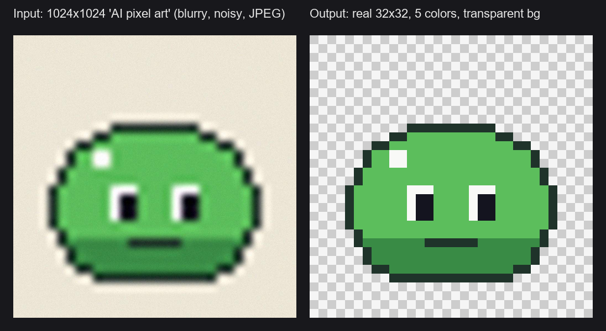
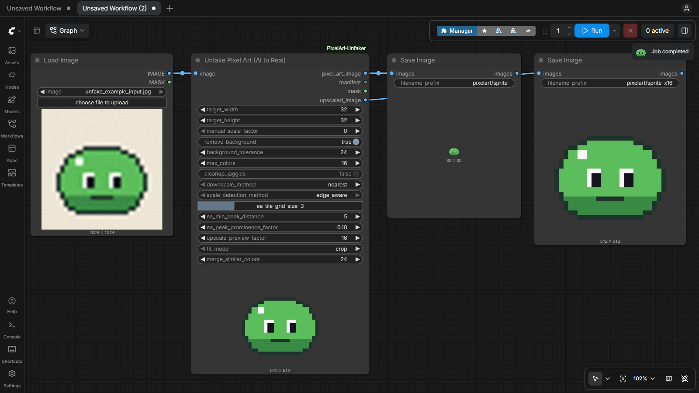

# ComfyUI Pixel Art Unfaker

A custom node for ComfyUI that transforms "fake" or blurry AI-generated pixel art into true, crisp pixel art: one pixel per art pixel, aligned to the grid, with a limited palette and a transparent background.

Based on the algorithm from [unfake.js](https://github.com/jenissimo/unfake.js) and inspired by the early adaptation [ComfyUI-Unfake-Pixels](https://github.com/tauraloke/ComfyUI-Unfake-Pixels).



## Features

* **Exact Target Resolution**: Get exactly `32x32`, `64x64`, `48x32`... Works with any input size, even when the "big pixels" of the AI image are not a whole number of real pixels, without stretching or half-pixels.
* **Grid Alignment**: The sampling grid is snapped to the edges of the art, so every output pixel reads the center of an art pixel.
* **Edge-Aware Scale Detection**: Leave the target size at `0` to auto-detect the pixel size of clean, upscaled pixel art.
* **Smart Background Removal**: Detects the background color from the image border and removes only the regions connected to it, so similar colors inside the sprite are kept.
* **Color Quantization**: Reduces the palette (median cut + k-means). Transparent pixels never waste palette slots.
* **Similar Color Merging**: Merges the near-identical shades that AI noise creates, so flat areas come out flat instead of speckled.
* **Optional Stray Pixel Cleanup**: Removes isolated noise pixels without introducing new colors (off by default).
* **Batch Support**: Process animation frames in one go. The pixel size detected on the first frame is reused for the rest.
* **Ready-to-save outputs**: Real-size image (with alpha), a nearest-neighbor upscaled copy, the transparency mask and a JSON manifest with the detected grid and palette.

## Installation

**ComfyUI Manager**: search for *Pixel Art Unfaker* and install.

**Manual**:
```bash
cd ComfyUI/custom_nodes/
git clone https://github.com/CalaKuad1/ComfyUI-PixelArt-Unfaker.git
cd ComfyUI-PixelArt-Unfaker
pip install -r requirements.txt
```
*(Windows portable: `..\..\..\python_embeded\python.exe -m pip install -r requirements.txt`)*

Restart ComfyUI. The node is in `image/postprocessing` as **Unfake Pixel Art (AI to Real)**.

## Quick start (example workflow)

1. In ComfyUI open **Workflow → Browse Templates**, choose **ComfyUI-PixelArt-Unfaker → unfake_pixel_art_basic**.
   (Or drag [`example_workflows/unfake_pixel_art_basic.json`](example_workflows/unfake_pixel_art_basic.json) onto the canvas.)
2. Copy [`example_workflows/unfake_example_input.jpg`](example_workflows/unfake_example_input.jpg) into `ComfyUI/input/`, or load your own image in **Load Image**.
3. Press **Run** (called **Queue** in older ComfyUI versions). You get the real 32x32 sprite and a 16x upscaled copy in `ComfyUI/output/pixelart/`.



It also works right after a KSampler / VAE Decode: plug the decoded image into the node.

### Tips

* **Which target size?** Count the "big pixels" across the AI image (or guess: most AI pixel art is drawn as 32, 48, 64 or 128 pixels wide) and use that as `target_width`. Set `target_height` to `0` to keep the aspect ratio.
* **Leftover background** around the sprite: raise `background_tolerance` (20–40 for noisy / JPEG images).
* **Speckled / blotchy areas**: raise `merge_similar_colors` (30–40). If subtle shading disappears, lower it.
* **Still noisy**: try `downscale_method = dominant`.
* **`cleanup_jaggies`** is off by default because it can remove intentional 1-pixel details (eyes, highlights). Turn it on only if there are lone stray pixels left.
* **No target size at all**: set both targets to `0` (auto-detect) or set `manual_scale_factor` to the size of one art pixel. Auto-detection works on integer upscales; for AI images, a target size is more reliable.

## How it works

1. **Background removal**: the background color is estimated from the image border and the regions connected to the border are made transparent.
2. **Grid size**: taken from the target size, from `manual_scale_factor`, or auto-detected from the spacing of the edges in the image.
3. **Grid alignment**: the grid is shifted so its lines fall on the edges of the art.
4. **Downscale**: one output pixel per grid cell (`nearest` or `dominant` color).
5. **Quantization**: the opaque pixels are reduced to at most `max_colors` colors, then near-identical colors are merged.
6. **Cleanup** (optional): isolated stray pixels are replaced with the color of their neighbors.

## Node Parameters

| Parameter | Description |
|---|---|
| `target_width` / `target_height` | Exact output size in art pixels. One of them `0` = keep aspect ratio. Both `0` = use `manual_scale_factor` or auto-detect. |
| `manual_scale_factor` | Size of one art pixel in input pixels (e.g. `16` turns 1024 into 64). `0` = auto-detect. |
| `remove_background` | Make the border-connected background transparent. |
| `background_tolerance` | Max per-channel difference (0–255) from the background color. |
| `max_colors` | Maximum palette size. `0` = keep all colors. |
| `cleanup_jaggies` | Replace isolated stray pixels with their neighbors' color. Off by default. |
| `downscale_method` | `nearest`: center pixel of each cell (cleanest in most cases). `dominant`: most common color of each cell (for very noisy images). |
| `scale_detection_method`, `ea_*` | Tuning for auto-detection (tile grid, minimum edge distance, edge strength). |
| `upscale_preview_factor` | Upscale for the node preview and the `upscaled_image` output (capped at 4096px). |
| `fit_mode` | When the aspect ratio differs from the target: `crop` (fill and cut), `pad` (fit with transparent borders) or `stretch`. |
| `merge_similar_colors` | Merge palette colors closer than this RGB distance (default `24`). Removes noise shades; `0` = off. |

### Outputs

| Output | Description |
|---|---|
| `pixel_art_image` | Real-size pixel art. RGBA when the background is removed or padding is added, RGB otherwise. |
| `manifest` | JSON with the pixel size, grid offset, output size and palette (hex). |
| `mask` | Transparent area in ComfyUI convention (1 = transparent, same as **Load Image**). |
| `upscaled_image` | Nearest-neighbor upscaled copy, ready to save or preview. |

## Changelog

**1.1.0**
* Example workflow and example image (Browse Templates).
* Exact target sizes without stretching, new `fit_mode` (crop / pad / stretch).
* Batch support, new `mask` and `upscaled_image` outputs, JSON manifest.
* Better grid alignment, background removal and `dominant` downscale on noisy AI images.
* Quantization ignores transparent pixels; new `merge_similar_colors` removes noise shades.
* `cleanup_jaggies` is now off by default and never adds new colors.
* No more scikit-learn dependency; much faster processing.

**1.0.0**
* First release.

## Credits & Acknowledgements

* **[jenissimo](https://github.com/jenissimo)** for the original **[unfake.js](https://github.com/jenissimo/unfake.js)** library and algorithm.
* **[tauraloke](https://github.com/tauraloke)** for **[ComfyUI-Unfake-Pixels](https://github.com/tauraloke/ComfyUI-Unfake-Pixels)**, the foundational inspiration for bringing this into ComfyUI.

## License

MIT License
